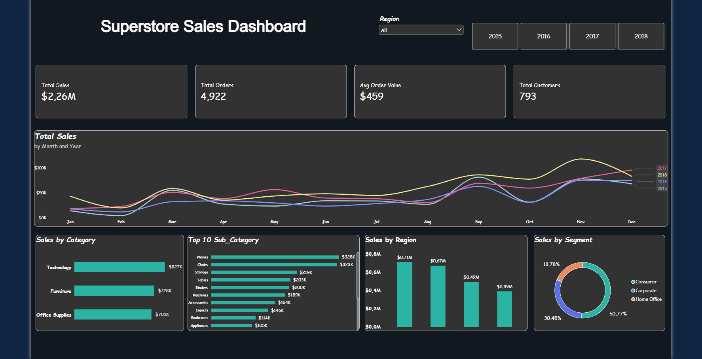

# Superstore Sales Analysis
*Retail sales performance 2015–2018 · SQL Server & Power BI*

## Overview
This project analyzes the sales performance of a US-based retail store (Superstore) between 2015 and 2018.
The goal is to identify sales trends over time, the best-performing product categories, and the most valuable regions and customer segments, and to present the results in an interactive Power BI dashboard.



## Dataset
- **Source:** [Superstore Sales Dataset – Kaggle](https://www.kaggle.com/datasets/rohitsahoo/sales-forecasting)
- **File:** `train.csv`
- **Size:** 9,800 rows, 18 columns
- **Key columns:** Order ID, Order Date, Ship Date, Ship Mode, Customer ID, Segment, Region, State, City, Category, Sub-Category, Product Name, Sales

## Business Questions
1. How do sales change over time (yearly and monthly)? Is there seasonality?
2. Which product categories and sub-categories generate the most sales?
3. Which regions and customer segments generate the most sales?

## KPIs
| KPI | Description |
|---|---|
| Total Sales | Sum of all sales |
| Total Orders | Number of unique orders |
| Average Order Value | Total Sales / Total Orders |
| Total Customers | Number of unique customers |

## Tools
- **SQL Server (SSMS):** data import, cleaning, and analysis queries
- **Power BI:** data modeling, DAX measures, and dashboard
- **GitHub:** version control and documentation

## Project Structure
```
Superstore-Sales-Analysis/
├── README.md
├── data/
│   └── train.csv
├── sql/
│   └── superstore_sales_analysis.sql
├── powerbi/
│   └── SUPERSTORE.pbix
└── images/
    └── Dashboard_SUPERSTORE.png
```

## Data Cleaning
Data was imported into SQL Server as a raw table (`sales_raw`) and cleaned into a new table (`sales_clean`) using `sql/superstore_sales_analysis.sql` (Parts A–D).

| Check | Finding | Action |
|---|---|---|
| Missing values | 11 missing postal codes, all for Burlington, Vermont | Filled with Burlington's postal code (05401) |
| Duplicates | 1 duplicate row (order US-2015-150119) | Removed, kept one copy |
| Dates | Stored as text in dd/mm/yyyy format | Converted to `DATE` |
| Sales | Stored as text | Converted to `DECIMAL`; no invalid or negative values found |
| Text columns | Possible extra spaces | Trimmed |
| Logic check | Ship date before order date | None found |

**Result:** 9,800 raw rows → 9,799 clean rows.

## Analysis
The analysis was performed in SQL Server using `sql/superstore_sales_analysis.sql` (section *Analysis queries*), based on the clean table (`sales_clean`).

### KPIs
Calculated Total Sales, Total Orders, Average Order Value and Total Customers to give an overall view of the business.

### Q1. Sales over time
- Total sales per year, with year-over-year growth (%) using the `LAG()` window function
- Total sales per month across all years, to identify seasonality

### Q2. Product performance
- Total sales and share (%) of total sales per category
- Top 10 sub-categories by sales

### Q3. Regions and customer segments
- Total sales, share (%) and number of orders per region
- Total sales, share (%) and number of customers per segment

**SQL techniques used:** aggregate functions (`SUM`, `COUNT DISTINCT`), `GROUP BY`, CTEs, window functions (`ROW_NUMBER`, `LAG`, `SUM() OVER()`), date functions (`YEAR`, `MONTH`, `DATENAME`), data type conversion (`TRY_CONVERT`).

## Power BI Dashboard

### Data model
- **sales** table: imported directly from SQL Server (`sales_clean`)
- **Date** table: created with DAX (`CALENDAR`), marked as date table and connected to `Sales[order_date]` (one-to-many)
- **Measures** table: holds all DAX measures

### DAX measures
| Measure | Purpose |
|---|---|
| `Total Sales` | `SUM` of sales |
| `Total Orders` | `DISTINCTCOUNT` of order IDs |
| `Avg Order Value` | Total Sales / Total Orders |
| `Total Customers` | `DISTINCTCOUNT` of customer IDs |
| `Sales PY`, `Sales YoY %` | Previous-year sales and growth using `SAMEPERIODLASTYEAR` |
| `Year Color`, `Chart Color` | Dynamic colors: charts and slicer buttons take the color of the selected year |

### Dashboard features
- 4 KPI cards (Total Sales, Total Orders, Average Order Value, Total Customers)
- Monthly sales by year (line chart), to show trend and seasonality
- Sales by category and Top 10 sub-categories (bar charts)
- Sales by region (column chart) and by segment (donut chart)
- Interactive year and region slicers, with dynamic colors based on the selected year

## Key Insights

### Overall
- Total sales of **$2.26M** from **4,922 orders** and **793 customers**, with an average order value of **$459**.

### Sales over time
- After a small drop in 2016 (**-4.2%**), sales grew strongly in 2017 (**+30.6%**) and 2018 (**+20.3%**). Sales in 2018 were about **50% higher** than in 2015.
- Sales are highly seasonal: **September to December generate 52% of yearly sales**.
- **November** is the best month ($350K) and **February** the weakest ($59K), almost 6 times lower.

### Products
- **Technology** is the top category (**36.6%** of sales), but the three categories are fairly balanced (Furniture 32.2%, Office Supplies 31.2%).
- **Phones** and **Chairs** are the top sub-categories and together generate about **29%** of all sales.

### Regions and customer segments
- **West** and **East** generate **61%** of sales, while **South** is the weakest region (**17.2%**).
- **East** has the highest average order value ($489), even though it has fewer orders than West.
- **Consumer** customers generate **50.8%** of sales. However, sales per customer are similar across all segments ($2,800–2,900), so Consumer leads because it has more customers, not because each customer spends more.

## Recommendations
- **Prepare for the end of the year:** increase stock and marketing from August, ahead of the September–December peak.
- **Boost the slow months:** run promotions in January and February to reduce the drop after the holidays.
- **Focus on top products:** keep Phones and Chairs well stocked and use them in campaigns and bundles.
- **Grow the South region:** investigate why sales are lower (fewer customers, fewer stores, less marketing) and test targeted campaigns there.
- **Grow the Corporate and Home Office segments:** since their customers spend as much as Consumers, acquiring more of them is a clear growth opportunity.

## How to Use
1. Download `train.csv` from the `data/` folder (or from Kaggle).
2. Import it into SQL Server and run `sql/superstore_sales_analysis.sql` part by part.
3. Open `powerbi/SUPERSTORE.pbix` in Power BI Desktop. To refresh the data, update the SQL Server connection to your own server (Home → Transform data → Data source settings).
